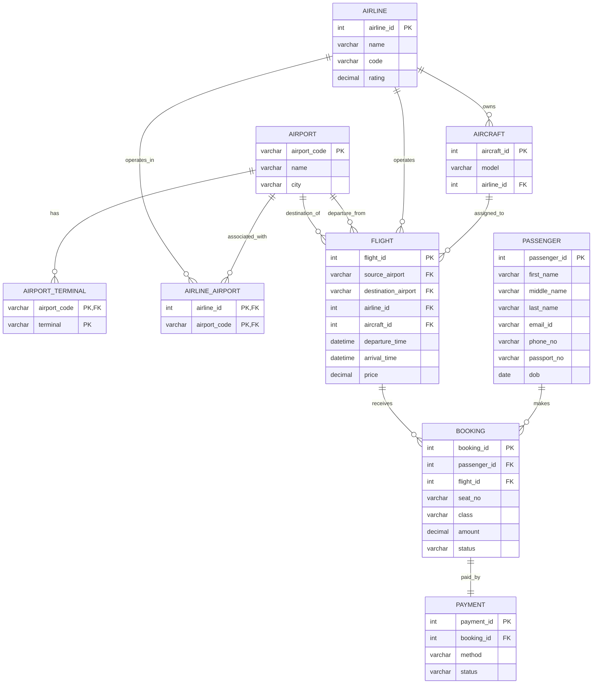

# ✈️ Airline Management System

**An Airline Management System designed to simplify and organize airline operations, flight information, passenger management, ticket reservations, and payment records through a user-friendly interface and a structured database.**

---

## 📌 Table of Contents

- [About the Project](#-about-the-project)
- [Project Objectives](#-project-objectives)
- [Key Modules](#-key-modules)
- [Key Features](#-key-features)
- [UI/UX Design](#-uiux-design)
- [Technology Stack](#-technology-stack)
- [Database Design](#-database-design)
- [Entity Relationship Diagram](#-entity-relationship-er-diagram)
- [Database Entities](#-database-entities)
- [Entity Relationships](#-entity-relationships)
- [Getting Started](#-getting-started)
- [Installation and Execution](#-installation-and-execution)
- [Project Structure](#-project-structure)
- [Future Enhancements](#-future-enhancements)
- [Academic Context](#-academic-context)

---

## 📖 About the Project

The **Airline Management System** is an academic DBMS course project that focuses on designing and developing a system to manage essential airline operations.

Airline operations involve several interconnected components, including airports, airlines, aircraft, flights, passengers, bookings, and payments. Managing these components requires a well-organized system that maintains relationships between different entities while ensuring data consistency and reducing redundancy.

This project aims to provide a centralized platform where airline-related information can be organized and managed efficiently.

The project combines a user-friendly UI/UX interface with a structured relational database design using **MySQL**.

The system is designed around the following major operations:

- Managing airport and airline information.
- Maintaining aircraft details and ownership records.
- Managing flight schedules, routes, and pricing.
- Maintaining passenger information.
- Handling flight reservations and booking records.
- Managing payment details and transaction status.

---

## 🎯 Project Objectives

The primary objectives of this project are:

1. To design and develop a structured relational database for airline operations.
2. To understand and implement database concepts such as entities, attributes, relationships, primary keys, and foreign keys.
3. To establish appropriate relationships between airlines, airports, aircraft, flights, passengers, bookings, and payments.
4. To maintain data consistency and minimize redundancy through database normalization.
5. To implement SQL operations for storing, retrieving, updating, and managing airline-related information.
6. To provide an intuitive user interface for demonstrating the functionality of the system.
7. To understand how a real-world management application interacts with a relational database.

---

## 🧩 Key Modules

The system is organized into the following major modules:

### 1. Airport Management
- Maintain airport information.
- Store airport codes, names, cities, and terminal details.
- Associate airlines with the airports they operate in.

### 2. Airline Management
- Maintain airline information.
- Store airline names, identification numbers, codes, and ratings.
- Manage airline ownership of aircraft.

### 3. Aircraft Management
- Maintain aircraft identification and model information.
- Associate aircraft with their respective airlines.
- Track aircraft assigned to flights.

### 4. Flight Management
- Maintain flight identification details.
- Manage departure and arrival airports.
- Store departure and arrival timings.
- Maintain flight prices.
- Associate flights with airlines and aircraft.

### 5. Passenger Management
- Store passenger personal information.
- Maintain passenger identification details.
- Store contact information, email addresses, passport numbers, and dates of birth.

### 6. Booking Management
- Maintain booking identification details.
- Associate bookings with passengers and flights.
- Store seat numbers, travel class, booking amount, and booking status.

### 7. Payment Management
- Maintain payment identification details.
- Store payment methods and transaction status.
- Associate payments with their corresponding bookings.

---

## 🚀 Key Features

The system is designed to support the following functionalities:

- **Airline Management:** Maintain airline information and associated aircraft.
- **Airport Management:** Store airport information and airline-airport associations.
- **Flight Management:** Maintain flight routes, schedules, aircraft assignments, and pricing.
- **Passenger Records:** Store and manage passenger details.
- **Flight Reservations:** Create and maintain booking records for passengers.
- **Seat and Class Management:** Maintain seat numbers and travel class information in bookings.
- **Payment Tracking:** Maintain payment methods and payment statuses.
- **Relational Data Management:** Maintain relationships between different modules using primary and foreign keys.

*Note: The availability of individual features depends on their implementation in the application.*

---

## 🎨 UI/UX Design

The user interface and user experience design for this project has been created using Figma.

The design focuses on providing a clean, intuitive, and organized experience for users interacting with the Airline Management System.

---

## 💻 Technology Stack

The project uses the following technologies and tools:

| Technology | Purpose |
|---|---|
| MySQL | Relational database management and storage |
| Figma | UI/UX design and prototyping |
| Node.js and npm | JavaScript development environment and dependency management |
| Frontend Framework | As configured in the project dependencies |
| Git and GitHub | Version control and project collaboration |

---

## 🗄️ Database Design

The database is designed using the relational database model.

The system consists of seven primary entities and one junction entity to represent the major components and their relationships.

### Database Entities

1. Airport
2. Airline
3. Aircraft
4. Flight
5. Passenger
6. Booking
7. Payment
8. Airline_Airport (Junction Entity)

### Database Concepts Implemented

The database design incorporates the following DBMS concepts:

- Primary Keys (PK)
- Foreign Keys (FK)
- One-to-One (1:1) Relationships
- One-to-Many (1:M) Relationships
- Many-to-Many (M:N) Relationships
- Composite Attributes
- Derived Attributes
- Junction Tables
- Database Normalization

---

## 📊 Entity Relationship (ER) Diagram

The following ER diagram represents the logical database design of the Airline Management System.

It illustrates the entities, their attributes, primary relationships, and cardinalities.

### ER Diagram – Airline Management System



### Important Notes

- `AIRLINE_AIRPORT` resolves the many-to-many relationship between Airline and Airport.
- `AIRPORT_TERMINAL` represents multiple terminals associated with an airport.
- Flight source and destination reference Airport through separate foreign keys.
- Age is a derived attribute calculated using the passenger's date of birth.
- Booking is a strong entity because it has its own primary key (`booking_id`).
- Seats available can be calculated using the flight's capacity and confirmed bookings rather than being stored as an independent attribute.
- The one-to-one Booking–Payment relationship assumes one payment record per booking.

---

## 🔗 Entity Relationships

The major relationships in the database are:

| Relationship | Cardinality | Description |
|---|---|---|
| Airline – Aircraft | 1:M | One airline owns multiple aircraft. |
| Aircraft – Flight | 1:M | One aircraft can be assigned to multiple flights. |
| Airline – Flight | 1:M | One airline operates multiple flights. |
| Airline – Airport | M:N | Multiple airlines can operate at multiple airports. |
| Airport – Flight (Source) | 1:M | One airport can be the departure point for multiple flights. |
| Airport – Flight (Destination) | 1:M | One airport can be the destination for multiple flights. |
| Passenger – Booking | 1:M | One passenger can make multiple bookings. |
| Flight – Booking | 1:M | One flight can have multiple bookings. |
| Booking – Payment | 1:1 | Each booking has one associated payment record. |

---

## ⚙️ Getting Started

Follow these instructions to download and run the project on your local machine.

### Prerequisites

Make sure the following software is installed:

- [Node.js](https://nodejs.org/)
- npm (included with Node.js)
- [Git](https://git-scm.com/)

For database development and execution:

- [MySQL Community Server](https://dev.mysql.com/downloads/mysql/)
- [MySQL Workbench](https://dev.mysql.com/downloads/workbench/)

---

## 📥 Installation and Execution

### Step 1: Clone the Repository

Open your terminal or command prompt and execute:

```bash
git clone <YOUR_GITHUB_REPOSITORY_URL>
```

Navigate into the project directory:

```bash
cd <PROJECT_DIRECTORY>
```

### Step 2: Install Dependencies

Install all the required project dependencies:

```bash
npm install
```

Alternatively:

```bash
npm i
```

### Step 3: Start the Development Server

Run the following command:

```bash
npm run dev
```

### Step 4: Open the Application

After the development server starts successfully, the terminal will display a local development URL.

Open that URL in your web browser to access the application.

---

## 📁 Project Structure

The project follows a frontend application structure. The exact directory organization may vary depending on the implementation.

```text
Airline-Management-System/
│
├── public/                 # Static assets
│
├── src/                    # Application source code
│   ├── assets/             # Images, icons and other assets
│   ├── components/         # Reusable UI components
│   ├── pages/              # Application pages
│   ├── styles/             # Styling files
│   └── ...                 # Other application modules
│
├── docs/                   # Project documentation and diagrams
│   └── ER_Diagram.png      # Entity Relationship Diagram
│
├── package.json            # Project dependencies and scripts
├── package-lock.json       # Dependency lock file
└── README.md               # Project documentation
```

*The above structure is illustrative. Refer to the actual repository for the implemented directory structure.*

---

## 🔮 Future Enhancements

The following enhancements can be considered for future development:

- Integration of the frontend with the MySQL database.
- User authentication and role-based access control.
- Real-time flight search and availability checking.
- Automated seat allocation.
- Online ticket booking and cancellation.
- Payment gateway integration.
- Generation of booking confirmations and e-tickets.
- Flight status tracking and notifications.
- Administrative dashboard for managing airline operations.
- Detailed reports and analytics for bookings and revenue.

---

## 🎓 Academic Context

**Project Name:** Airline Management System  
**Subject:** Database Management Systems (DBMS)  
**Database:** MySQL  
**Project Type:** Academic Course Project

This project demonstrates the practical application of relational database concepts through the design of an airline management application.

It focuses on database modeling, entity relationships, relational schema design, normalization, SQL operations, and the integration of database functionality with a user interface.

---

**Developed as part of the Database Management Systems course project.**
